# Design

This document explains how the gem works, for contributors and for anyone reviewing it against Solid Queue. You don't need to read the code to follow it, and [Where it lives](#where-it-lives) maps each idea to its file. The [README](../README.md) describes the behaviour applications can rely on. Everything here can change between versions.

## The gem in one picture

Many `perform_later` calls with the same key share one pending job. A row in a new table marks that job as open. The row goes away when the job starts, so a call that arrives after that opens a new job.

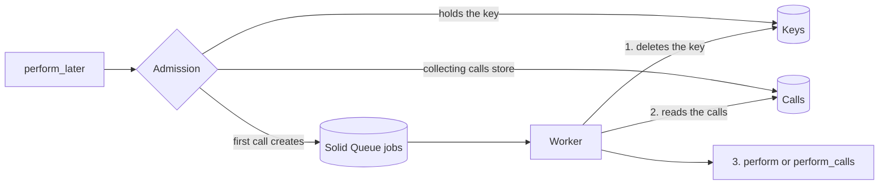

A class chooses what happens to a call that finds an open job:

- A discarding class, the default, drops the call. The job runs once, from its first call's arguments.
- A collecting class stores the call. The job runs once with every call it stored, up to `max_calls`.

## Terms

| Term | Meaning |
| --- | --- |
| Admission | The step in an enqueue that decides whether a call creates a job, joins one or is dropped |
| Open job | A job with a key row, which calls can still join |
| Sealing | Deleting a key row while its job waits, so the next call opens a new job |
| Execution | Solid Queue's row for where a job is: scheduled, ready, blocked, claimed or failed |
| Semaphore | Solid Queue's row for counting runs under `limits_concurrency` |
| Dispatcher | The Solid Queue process that makes scheduled jobs ready when they're due |
| Share lock | A row lock that other share locks can hold too. An exclusive lock waits for all of them |
| Exclusive lock | A row lock that one transaction holds, with everyone else waiting |
| Skip locked | A read that passes over a locked row instead of waiting for it |
| Gap lock | InnoDB's lock on the space between index rows, which blocks inserts there |
| Snapshot | What a MySQL `REPEATABLE READ` transaction sees. Its first plain read fixes it |

## Tables

The gem adds two tables and never alters Solid Queue's. Both have a foreign key to `solid_queue_jobs` with `on_delete: :cascade`.

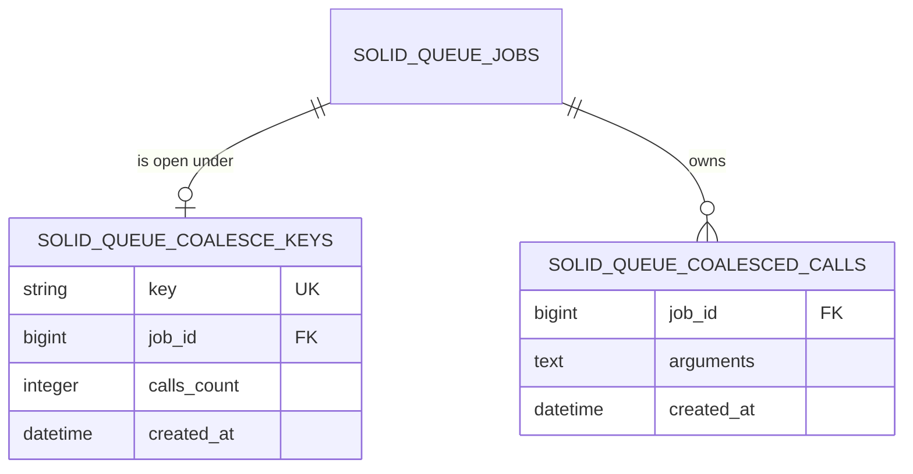

`solid_queue_coalesce_keys` has one row per open job. A row means that job exists, hasn't started and has room. `calls_count` is how many calls the job owns. A sealed or started job has no row.

`solid_queue_coalesced_calls` has one row per collected call, holding its Active Job payload. A row points at the job that owns it. Solid Queue only deletes these rows along with their job.

Until an app runs the gem's migration, everything else works as before. Only enqueuing a class that coalesces raises.

## Life of a key

A key row is either reserved, discarding or collecting. Deleting it never touches its job or the job's calls.

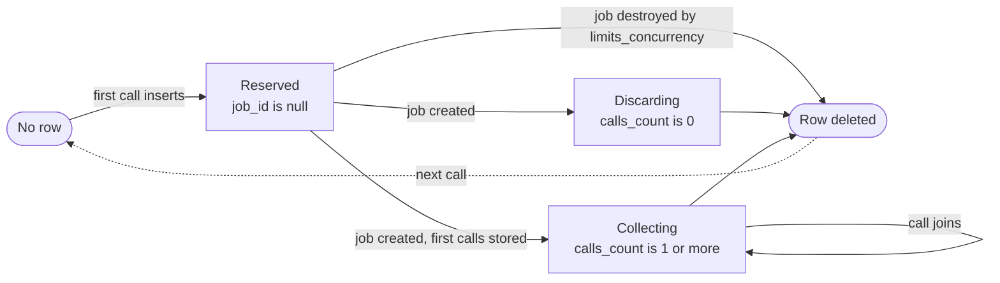

Reserved only exists inside the transaction that inserted the row, so other transactions never see a null `job_id`.

| What deletes the row | Applies to | What happens to the job |
| --- | --- | --- |
| The job fills | Collecting | Waits for its time, or dispatches with `on_full: :dispatch` |
| The class changed, or `max_calls` shrank, and a call seals it | Either | Waits for its time, and no call joins it again |
| The job starts, fails or is destroyed, or it finishes while `preserve_finished_jobs` is on | Either | See [Release](#release) |

## Admission

`SolidQueue::Job.enqueue` and `enqueue_all` are prepended, so every enqueue passes through here, including those from `RecurringTask`. A call coalesces if its class's key declaration is truthy and `executions` is zero, so a retry never does. Like upstream, `nil` and `false` disable it, while blank strings and unsupported truthy types still build a key scoped to the class and batch.

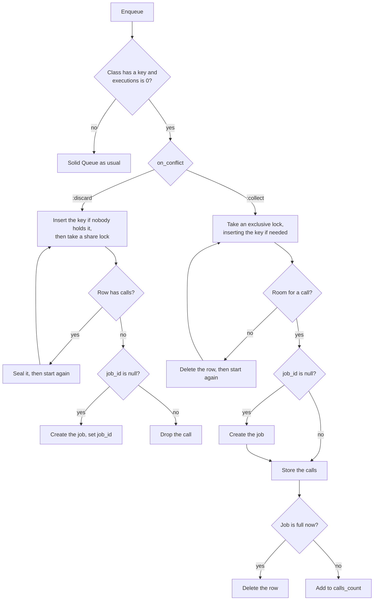

### Discarding calls

Discarding calls only read the key row, so they share its lock. A job start has to delete the row, so it waits for all of them, and every call that got the lock is covered by the run.

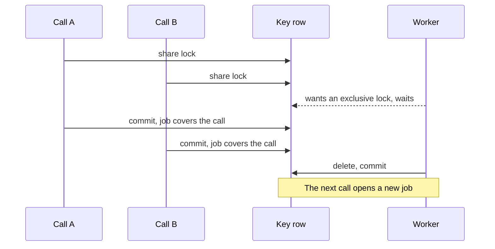

### Collecting calls

A collecting call takes an exclusive lock, because it goes on to change the row. Nearly every call finds a row, so it tries the lock before the insert. On MySQL, an insert that hits a duplicate locks the row and the gap next to it, and the calls queued on a row that gets sealed would deadlock on those locks.

The call stores its payload in a call row, then adds to `calls_count`, or deletes the key row once the job is full. Deleting the row seals the job, and sealing alone changes nothing about the job.

### Filling with `on_full: :dispatch`

The call that seals a job also dispatches it, in the same transaction, so workers can't see the job before its last call.

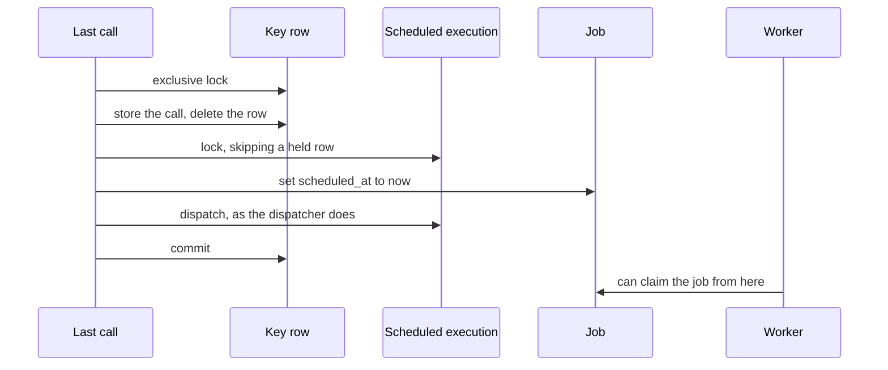

Moving `scheduled_at` matters because `FailedExecution#retry` checks `due?`, and would send the job back to its old time. A job with no scheduled execution is left as it is, because it's ready, blocked or claimed already. A job sealed without taking a call doesn't dispatch.

### Debouncing

With `debounce:`, each call works out a time for itself when admission sets `scheduled_at`, for single and bulk enqueues. It's the call's own time if the adapter's `enqueue_at` passed one, and otherwise now plus the window, capped at `max_wait` from now.

The calls that join then move the job once, to the latest of their times, capped at the key's `created_at` plus `max_wait`. With `debounce: 30.seconds, max_wait: 5.minutes`:

| Time | Event | Call's time | Job runs at | Why |
| --- | --- | --- | --- | --- |
| 0:00 | Call opens the job | 0:30 | 0:30 | The first call sets the time, and the key's clock starts |
| 0:20 | Call joins | 0:50 | 0:50 | Later than the job's time |
| 0:20.5 | Call joins | 0:50.5 | 0:50 | Less than a second later, so nothing is written |
| 4:50 | Call joins, after more calls kept it moving | 5:20 | 5:00 | Capped at the key's `created_at` plus `max_wait` |

The move changes `scheduled_at` on the job and on its scheduled execution, for the same reason as a dispatch. A fill with `on_full: :dispatch` dispatches instead of moving. A sealed job has no key, so nothing moves it again.

The app sets the key's `created_at` on insert, because MySQL's `CURRENT_TIMESTAMP` uses the server's time zone, and that clock has to match the app's `scheduled_at`.

### When a class changes

A job that gets a key has a `solid_queue_coalesce_on_conflict` marker in its payload, and only the job's row has it, not its calls. The marker outlives the class's declaration, so a worker can tell how a job was created after a deploy changes the class.

| The class now | The open job was | What the next call does |
| --- | --- | --- |
| Discards | Collecting | Seals it after the transaction that found it, then opens a new job. The old job fails on a worker, with its calls. See [Running a job](#running-a-job) |
| Collects | Discarding | Seals it and opens a new job. The old job runs one call from its own arguments |
| Collects, with a smaller `max_calls` | Collecting, over the new limit | Seals it and opens a new job |

## Release

The key is released when a job starts, fails, is destroyed, or finishes while `preserve_finished_jobs` is on. A row always means a live job, because a key left on a finished job would accept calls that never run.

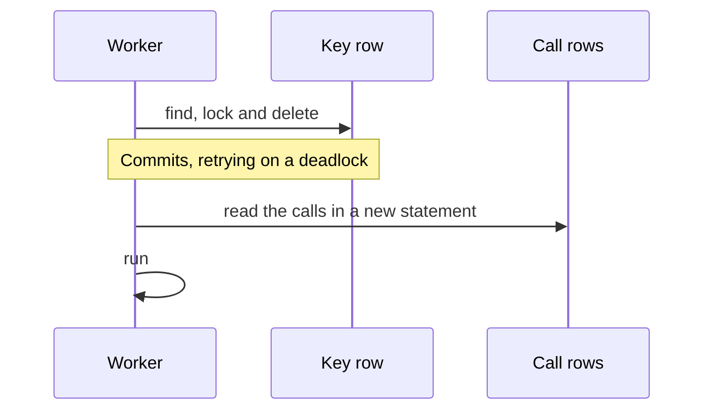

The release commits before the worker reads the calls. The read that finds the key sets the snapshot of a MySQL `REPEATABLE READ` transaction, so a read in the same transaction could miss calls committed while it waited for the lock.

## Running a job

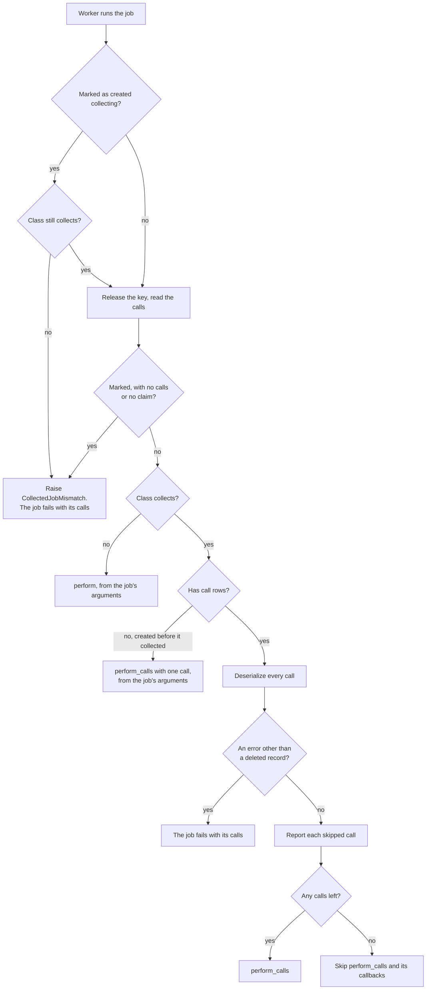

The start step runs first in `perform_now`, outside the `rescue_from` of Active Job's own `perform_now`, so `retry_on` can't swallow what it raises. The error reaches `ClaimedExecution#execute`, which turns it into a failed execution with its calls. It only applies to a job a worker has claimed, so a plain `perform_now` runs one call of its own.

A job whose class has stopped coalescing skips the release here, and its key goes when the job finishes.

A job created collecting never falls back to its own arguments, which are a copy of its first call's. A job created before its class collected has no call rows, so it runs one call from its arguments.

A call whose record is gone is skipped for this attempt. Reading the calls never deletes them, and every row stays until its job is destroyed. Retries and re-runs deserialize all the rows again, so still-missing records are skipped and reported again, and a restored record's call can run. Skipped-call notifications go out only after every call has deserialized without another error.

The job's own arguments can name a deleted record too. That doesn't fail the run, because the call's row decides what happens to it. The worker uses the stored `concurrency_key`, because it can't compute it from arguments that are gone.

A collecting job that conflicts under `limits_concurrency` always blocks, whatever its class says now. If the conflict destroyed the job, it would take its calls with it. A class can't declare `:collect` together with `on_conflict: :discard` on its concurrency limit, so this only matters after a class changes.

## Retries

Solid Queue's retry is a new job row with the same `active_job_id`. A call stays with its work across retries, so its `job_id` changes. The calls move to the new job in one transaction, and the old job finishes with none.

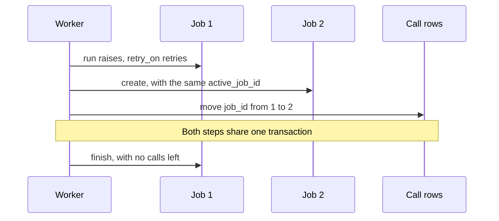

| If | Then |
| --- | --- |
| The new job isn't persisted, because a concurrency limit discarded it | The retry raises, and Job 1 fails with its calls |
| `retry_job` doesn't enqueue for any other reason | The retry raises, and Job 1 fails with its calls |
| The job's class now uses another adapter | The retry raises `CollectedJobMismatch` before enqueuing, because only Solid Queue moves calls, and Job 1 fails with its calls |
| Someone retries the failed execution | Solid Queue reuses the row, so the calls stay where they are |

A retry can't join or suppress anything, because `executions` is above zero. Debouncing doesn't apply to it either.

## Lock order

Admission locks the key, then the job and its semaphore. Everything else has to take the key first.

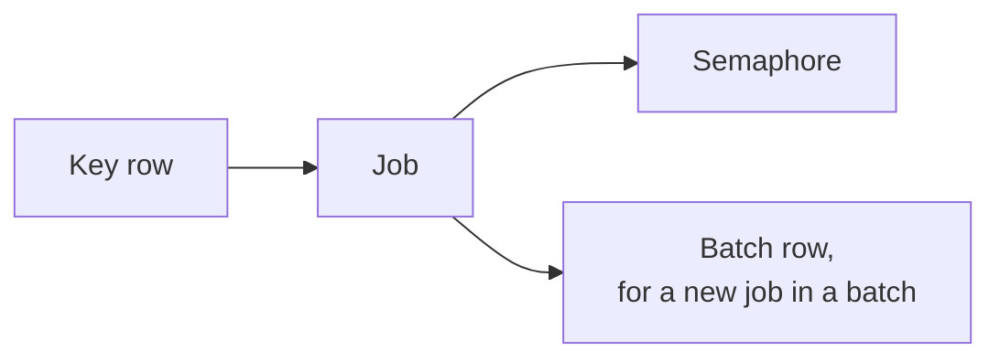

This is the deadlock the order prevents, if a job destroy were left to the foreign key cascade:

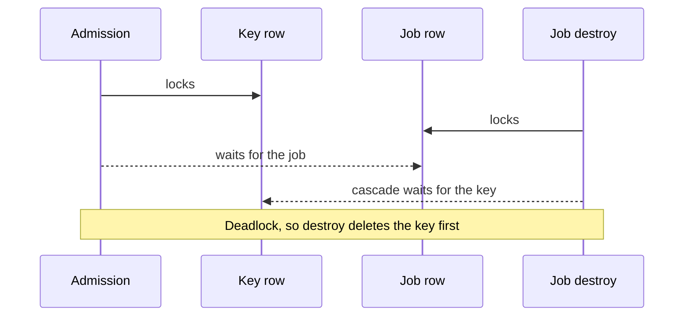

| Path | How it takes the key first |
| --- | --- |
| Destroying a job | `before_destroy :release_coalesce_key` is prepended, so it runs before anything else |
| Failing or finishing a job | `failed_with` and `finished!` release the key before calling `super` |
| Bulk discards | `CoalesceKey.release_all` runs before `super`, in key order, so two of them can't deadlock with each other |
| Finding a job's key | `lock_for_release` finds the row's key and then locks through the key's index. Locking through the `job_id` index takes InnoDB's locks on the row's indexes in the opposite order to admission |
| Bulk enqueues | Calls sort by key, with one transaction per discard admission or collecting job, so one call holds one key's lock at a time. Inside a batch's transaction they hold them all until it commits. See [Batches](#batches) |

### The exception

`on_full: :dispatch` and moving a debounced job lock a scheduled execution while holding the key, and a discard holds that execution while it waits for the key. So they use `non_blocking_lock`, and skip a row that's held.

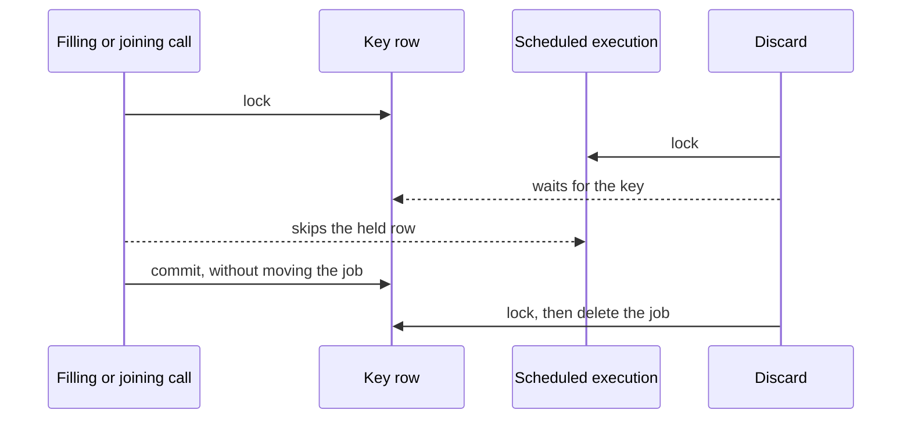

The holder is either the dispatcher, which is dispatching a job that's due, or a discard. It's why both are best effort:

- A discard that rolls back leaves the job at its old time.
- A lost move can only make a job run early, and the job still covers the call, because the key is held until it starts.
- `:discard` keeps its share lock when it moves a job, because a move doesn't change the key row. Calls sharing that lock skip each other's held row too.
- A move only matches an execution more than a second before the new time, so it's later-only under the lock, and hot keys skip the write.
- Both check that the row exists first, because on MySQL a locking read of a missing row takes a gap lock. A stale snapshot can only leave the job at its old time too.

With `use_skip_locked` off, `non_blocking_lock` waits, and a fill or a move and a discard of the same job can deadlock. Admission retries unless it's nested, and a single discard has no retry. That takes a non-default setting and a discard racing a call, so we accept it.

A `Job#discard` that loaded the scheduled execution before the fill dispatched the job raises `ActiveRecord::RecordNotFound` when it locks the row. The same happens when the dispatcher gets there first.

## Enqueue errors

Single coalesced enqueues wrap Active Record errors from key computation, payload serialization and admission in `SolidQueue::Job::EnqueueError`, retaining the cause and backtrace. Shared bulk admissions raise the original error. The wrapper ends before outcomes and `coalesce.solid_queue` events are published, so subscriber errors propagate unchanged, even after work has committed. Retrying a collecting job still wraps creation and transfer of its calls together.

## Deadlock retries

`retrying_deadlocks` wraps admission, the release when a job starts, and bulk discards. Most of these deadlocks come from InnoDB. Admissions waiting on a key that doesn't exist yet hold gap locks that block each other, and creating a job can do the same on a new semaphore.

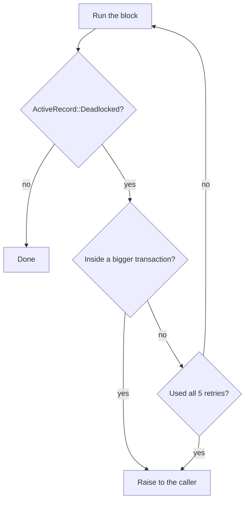

The first attempt plus five retries makes six attempts at most. Inside a bigger transaction it raises straight away, because InnoDB has already rolled all of that transaction back and only the caller can run it again.

A discarding call that finds a collecting job seals the key after the transaction that found it. Every call waiting on the key holds the same share lock, and upgrading it would deadlock with all of them. Inside the caller's own transaction it can't run after, so that deadlock can reach the caller.

`failed_with` has no retry. A deadlock there can stop the worker, with the error Solid Queue raises for a job it can't finalize.

## Batches

A batched key starts with its batch, so a call only finds a job in its own batch. A batch column would need a composite unique index, where null batch IDs wouldn't conflict. Unbatched keys can't collide with the prefix, because they start with a job class.

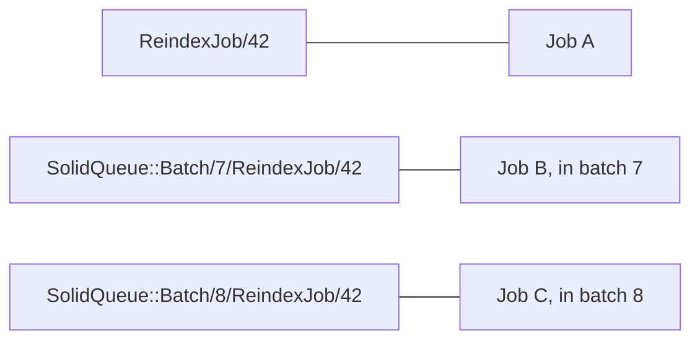

Solid Queue's accounting stays authoritative:

- A job created by admission carries its `batch_id`, and upstream's callbacks add its batch execution and count it. A call that joins touches neither.
- A key row means the job hasn't started and still has its batch execution, and everything that ends a job releases the key first, so a batch can't finish between a join and the job's run.
- Without a key, a new job goes through upstream's guard, which raises `AlreadyFinished` for a finished batch.
- Each coalesced job belongs to one batch, so workers don't change.

Admitting a new key takes the key, then the job, then the batch's row, for `total_jobs`, and keeps them until the transaction commits. A later key in the same block waits with the batch's row held, so two blocks adding different new keys to one batch can deadlock. Each block here is a `Batch.enqueue`.

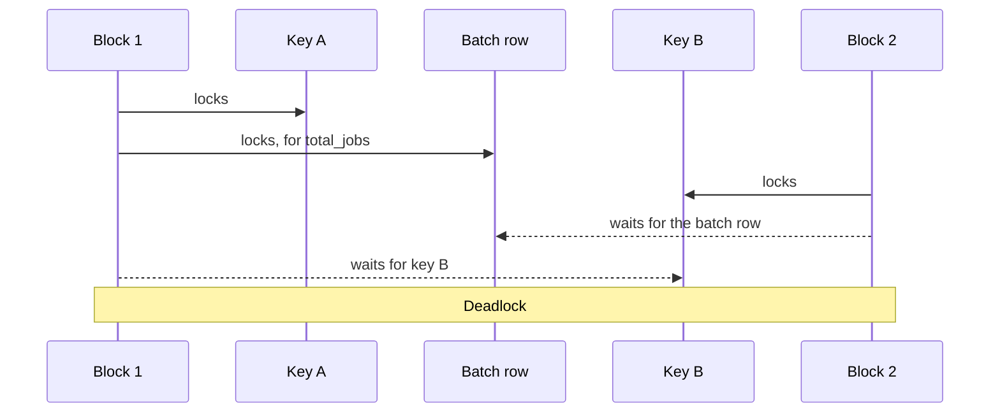

`retrying_deadlocks` can't help inside `Batch.enqueue`. Keys of different batches never contend, and a single call per block has no second key to wait for. We document this rather than handle it, because batches added to concurrently with many keys in a block are rare.

## Cost for other jobs

A job only pays for the gem if it might hold a key.

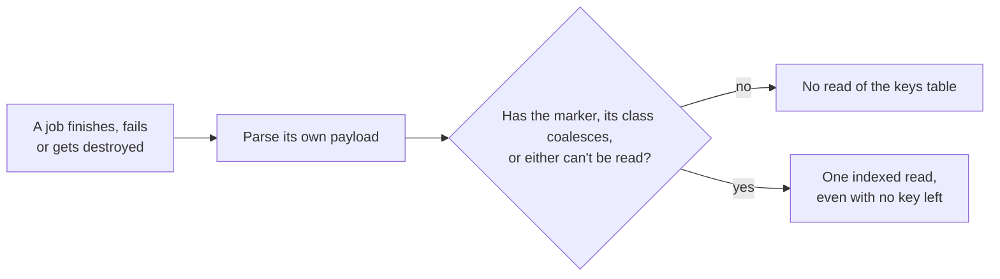

Solid Queue's bulk discards do one read per pass, whatever the jobs are. [The benchmarks](../test/benchmarks/README.md) have the numbers.

## Where it lives

| Idea | File | Names |
| --- | --- | --- |
| Declaring `coalesce`, running a job | `lib/active_job/coalescing.rb` | `coalesce`, `perform_now`, `retry_job`, `_perform_job` |
| Admission, retries, the start step | `app/models/solid_queue/job/coalescible.rb` | `enqueue_coalesced`, `continuing_coalesced_run`, `start_coalesced_run`, `retrying_deadlocks` |
| Key locking and sealing | `app/models/solid_queue/coalesce_key.rb` | `admit`, `admit_exclusively`, `lock_for_release`, `seal_collecting`, `release_all` |
| Stored calls | `app/models/solid_queue/coalesced_call.rb` | `waiting` |
| Every place the gem reaches into Solid Queue | `lib/solid_queue/coalesce/patches.rb` | `Enqueuing`, `Failing`, `Finishing`, `ConcurrencyConflicts`, `BulkDiscarding` |
| Tables | `lib/generators/solid_queue/coalesce/install/templates/db/create_solid_queue_coalesce_tables.rb` | |
